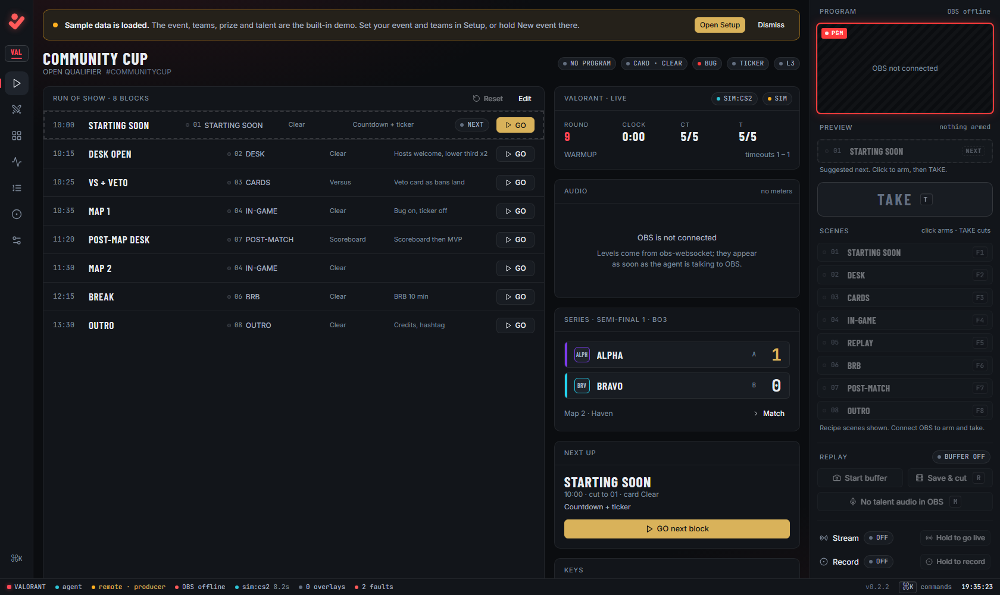
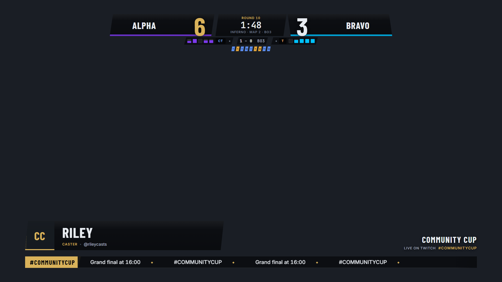

# Clear to Air

Clear to Air is a control room for esports tournament streams. It runs on the
broadcast PC next to OBS, reads live data from the game where the game offers it,
and drives the overlays, the scenes and the run of show from one browser tab.

It is free and open source. Website: [cleartoair.com](https://cleartoair.com).

> **Status: early.** Every pack and adapter is tested against built-in simulators
> and sample payloads shaped from each game's documentation. Testing against real
> games and real shows is in progress. Expect rough edges, and please
> [report them](https://github.com/downstagehq/cleartoair/issues).



*The control room, opened as a remote producer seat, on the built-in demo event.*



*The CS2 in-game overlay: scorebug, round history, caster lower third and ticker.*

## What it does

- **Runs the show from a browser.** A run of show with one GO per block, ARM then
  TAKE for anything that goes to air, program and preview thumbnails, F1 to F8
  scene hotkeys, a command palette, replay buffer, talent mute, and hold-to-confirm
  for going live or recording.
- **Builds the OBS side for you.** Generates and installs a complete OBS scene
  collection for the title, with every overlay already added as a browser source,
  and warns when the collection in OBS has drifted from it.
- **Checks itself before you go live.** Preflight runs every 10 seconds and lights
  the lamp: clear, warnings or faults, each with a plain fix. Watchdogs catch
  things like a caster's camera on screen while their audio has gone silent. A
  rehearsal walks every scene and checks the talent audio without cutting program
  while you are streaming or recording.
- **Ships the graphics.** Overlay packs for eight titles: scorebug, full-frame
  cards (versus, veto or draft, standings, roster, bracket, scoreboard, MVP,
  head-to-head, schedule and more), standby screens and desk nameplates. Your
  event's colours and font override the pack's.
- **Reads live data where the game allows it,** through the publisher's own
  interfaces. Nothing reads game memory or draws on the game window.
- **Rehearses without the game.** A simulator for every title feeds realistic
  rounds, goals, kills and drafts.
- **Saves typing.** Team lookup from Liquipedia, bracket and entrant import from
  start.gg, and a scoreboard you can paste in as text.
- **Lets crew work from elsewhere.** Producer, scorer and viewer seats through a
  relay, so a scorer at the other end of the venue can keep the score.
- **Installs as a folder.** The Windows build is a zip with its own Node runtime
  and a tray lamp. It checks for updates and only installs one that comes over
  https with a matching checksum.

## Supported games

| Game | Pack | Data source |
|---|---|---|
| Counter-Strike 2 | `cs2` | **Live**: Valve Game State Integration. Run the observer client on the same PC. |
| Dota 2 | `dota2` | **Live**: Valve Game State Integration (`-gamestateintegration` launch option). Spectate for both teams. |
| League of Legends | `lol` | **Live**: Riot's Live Client Data API, read from the game client on the same PC. |
| Rocket League | `rocketleague` | **Live**: Psyonix's Stats API. Falls back to SOS (BakkesMod) for LAN matches with anti-cheat off. |
| Apex Legends | `apex` | **Live**: Respawn's LiveAPI from a custom lobby with an observer. Some details still need confirming in a real lobby. |
| VALORANT | `valorant` | **Manual**: there is no live API. Score from the Match tab or a pasted scoreboard. |
| EA SPORTS FC | `eafc` | **Manual**: Match tab. Bracket import from start.gg. |
| Fighting games (Street Fighter 6, Tekken 8, Guilty Gear Strive, Mortal Kombat 1 and others) | `fgc` | **Manual**: Match tab. Bracket import from start.gg. |

Every title also works fully by hand from the Match tab. The adapter notes in
[`agent/src/adapters/README.md`](agent/src/adapters/README.md) say exactly what
each feed provides and what is still unconfirmed.

## Quick start

**Download (Windows 10/11, 64-bit):**

1. Get `ClearToAir-win64-<version>.zip` from the
   [Releases page](https://github.com/downstagehq/cleartoair/releases).
2. Unzip it somewhere you can write to, such as Documents (not Program Files).
3. Double-click **Clear to Air.exe**. The lamp appears in the tray and the control
   room opens at `http://127.0.0.1:7700/`.
4. In OBS Studio, switch on the WebSocket server (Tools → WebSocket Server
   Settings), then follow the Setup tab.

The demo event is loaded on first start, so you can try everything with a
simulator before you set up your own teams.

**From source** (Node.js 22 or newer):

```
git clone https://github.com/downstagehq/cleartoair.git
cd cleartoair
npm run setup
npm run build
npm start
```

On Windows, `Clear to Air.cmd` does all of that and opens the control room.
[CONTRIBUTING.md](CONTRIBUTING.md) has the developer setup and tests.

## The hosted control room

Remote seats let a producer, scorer or viewer use the same control room from
another laptop. The broadcast PC dials out one WebSocket to a small relay
(`relay/`, a Cloudflare Worker and Durable Object), so nothing on the broadcast PC
is opened to the internet. The operator hands out invite links per seat and admits
producers by hand. Every request is checked on the broadcast PC against a
deny-by-default policy, and passwords and tokens are stripped before anything
leaves it. You can run your own relay on Cloudflare's free plan with one
`npx wrangler deploy` (see [`relay/README.md`](relay/README.md) and
[`docs/REMOTE.md`](docs/REMOTE.md)). The relay has been tested end to end on a
local harness; it has not yet been run on Cloudflare. A hosted relay run by
Downstage is planned.

## Licence

- The application (agent, control room, relay, tools) is under the
  [GNU AGPL v3](LICENSE), or (at your option) any later version
  (SPDX: `AGPL-3.0-or-later`). You can use, change and run it for free, including
  commercially. If you distribute a changed version, or run one as a service for
  other people, you must publish your changes under the same licence.
- The overlay packs in `packs/` and the shared overlay renderer in
  `overlays/_shared/` are under the MIT licence ([packs](packs/LICENSE),
  [renderer](overlays/_shared/LICENSE)), so a pack stands entirely on its own: you
  can build, keep private or sell your own packs.
- The name "Clear to Air", the lamp mark and the wordmark are trademarks and are
  not covered by either licence. Forks must use their own name and logo. See
  [TRADEMARKS.md](TRADEMARKS.md).
- Fonts, libraries, data sources and game trademarks are listed in
  [THIRD_PARTY_NOTICES.md](THIRD_PARTY_NOTICES.md). Clear to Air is not affiliated
  with or endorsed by any game publisher.

## How it is funded

The code stays free. The work is paid for by:

- **Supporters**, monthly or once-off:
  <!-- PLACEHOLDER: GitHub Sponsors, Open Collective, Ko-fi and Paystack links -->
- **Sponsors**: esports organisations, hardware brands, venues and leagues, listed
  here, on [cleartoair.com](https://cleartoair.com) and on the app's About screen. Write to hello@downstage.co.za.
  <!-- PLACEHOLDER: sponsor logos once there are any -->
- **Setup and support**: Downstage can set up and run Clear to Air for a league or
  event, train the crew, and build custom packs: hello@downstage.co.za.

## Contributing

Bug reports, real game payloads, new packs and adapters are all welcome. Start
with [CONTRIBUTING.md](CONTRIBUTING.md). Please read the
[Code of Conduct](CODE_OF_CONDUCT.md), and report security problems privately as
described in [SECURITY.md](SECURITY.md). Questions and show reports go to
[GitHub Discussions](https://github.com/downstagehq/cleartoair/discussions).
