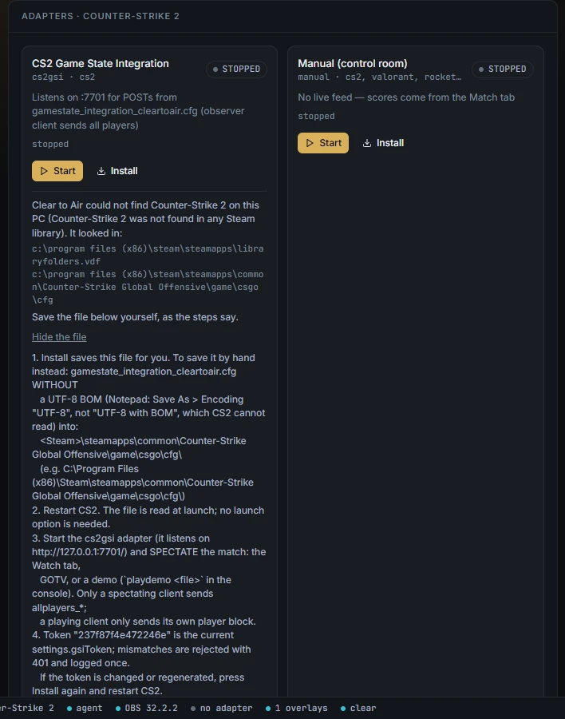
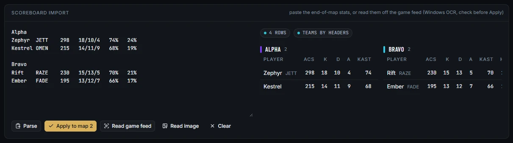
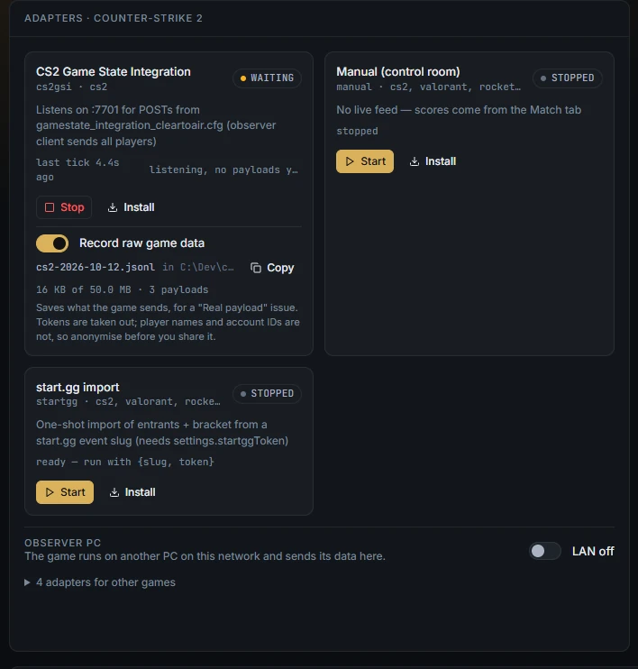

# Game data adapters

Connect a game's live data to Clear to Air, or score by hand where a game has no live data.

An adapter reads the data a game's publisher offers and feeds it to the graphics. Nothing reads game memory or draws on the game window. All adapters live on the **Data** tab, one card each, with **Start**, **Stop** and **Install**. The pill on each card reads **connected**, **waiting** or **stopped**. The cards for the current title come first; the rest are folded under "adapters for other games".

An adapter you start comes back by itself after the agent restarts. Simulators do not.

**Status.** Every adapter was written from the publisher's documentation and tested against simulators and sample payloads shaped from it. Testing against real games is in progress. If you run one against a real game, please record what it sends and share it (see [Record raw game data](#record-raw-game-data)).

| Game | Adapter card | How data arrives | Port |
|---|---|---|---|
| Counter-Strike 2 | CS2 Game State Integration | The game posts to Clear to Air | 7701 |
| Dota 2 | Dota 2 Game State Integration | The game posts to Clear to Air | 7702 |
| League of Legends | LoL Live Client Data | Clear to Air polls the game client every second | 2999 |
| Rocket League | Rocket League Stats API / SOS | Clear to Air connects to the game | 49123, then 49122 |
| Apex Legends | Apex Legends LiveAPI | The game connects to Clear to Air | 7777 |
| Any title | Manual (control room) | None: scores come from the Match tab | none |

Every port is on this PC only (`127.0.0.1`). The game, or its spectator client, must run on the broadcast PC. The one exception is CS2 and Dota 2 from an [observer PC](observer-pc.md).



## Connect CS2

**What it provides:** map name, round number, phase, round and bomb clocks, bomb state, team names and scores, round history, and each player's health, armour, money, kills, deaths, assists and active weapon. Events: round end, bomb planted, defused or exploded, kills, match start and end.

1. Data tab → **CS2 Game State Integration** → **Install**. Clear to Air finds CS2 through your Steam libraries and saves `gamestate_integration_cleartoair.cfg` into `...\Counter-Strike Global Offensive\game\csgo\cfg\`.
2. Restart CS2. It reads the file at launch. No launch option is needed.
3. Press **Start** on the card.
4. Spectate the match: the Watch tab, GOTV, or a demo with `playdemo <file>`. A client that is playing only sends its own player, not all ten.

If a different `gamestate_integration_cleartoair.cfg` is already there, Install asks first. **Replace it** keeps the old one as a `.old` file. If Install cannot find the game, it shows the file and every folder it looked in. Press **I'll save it myself**, copy the file, and save it without a UTF-8 BOM. CS2 cannot read a file saved as "UTF-8 with BOM".

The file carries a token, and payloads with the wrong token are refused. The token is in Setup → Connections → **GSI token**, made up for your install on first start. If you change it, press **Install** again and restart CS2.

**Still unconfirmed:** when CS2 advances its round counter on a real server. Clear to Air works out the round from the two scores instead.

## Connect Dota 2

**What it provides:** game clock, phase (including the draft), Radiant and Dire kill scores, each player's hero, level, gold, net worth, last hits, denies, GPM, XPM, items, respawn time, Aghanim's and Aegis. Also the draft picks and bans, Roshan's state, and the organisations' names when you spectate a league match.

1. Data tab → **Dota 2 Game State Integration** → **Install**. It saves the cfg into `...\dota 2 beta\game\dota\cfg\gamestate_integration\`, creating that last folder if needed.
2. In Steam, add the launch option `-gamestateintegration`: Dota 2 → **Properties** → **Launch Options**. Without it, Dota 2 sends nothing.
3. Restart Dota 2.
4. Press **Start** on the card and spectate the match, or watch through DotaTV.

Outside a league match, the sides show as Radiant and Dire, and your team names from the Match tab are used. The token works as it does for CS2.

**Still unconfirmed:** whether live payloads include Radiant's win chance. The graphics leave it out when it is missing.

## Connect League of Legends

**What it provides:** game clock, each player's champion, kills, deaths, assists, CS, level, items, ward score and respawn timer, team kill totals as the score, and dragon, baron, herald, tower and inhibitor counts. Events include dragon, baron and herald kills, champion kills, towers, inhibitors, first blood, multikills and aces.

1. Nothing to install. The League client serves its Live Client Data API while a game is running.
2. Spectate the match on the broadcast PC, in Spectator mode or from a replay, so every player is included.
3. Data tab → **LoL Live Client Data** → **Start**.

The card is connected while a poll succeeded in the last 5 seconds.

Riot's policy forbids overlays drawn on the game window. An OBS browser-source overlay on the broadcast is fine, and that is all Clear to Air does.

## Connect Rocket League

**What it provides:** team names, colours and scores, the clock (counting up in overtime), phase, and each player's boost, score, goals, saves, shots, demos and touches. Also ball speed, the last goal's scorer, assist and speed in km/h, and the winner.

Rocket League's own Stats API is the main feed and works online:

1. Close Rocket League.
2. Open `<Install Dir>\TAGame\Config\DefaultStatsAPI.ini`. Some guides call it `TAStatsAPI.ini`; edit whichever exists.
3. Under `[TAGame.MatchStatsExporter_TA]`, set `PacketSendRate=30` and `Port=49123`. `PacketSendRate` is the on switch: 0 is off, the maximum is 120.
4. Start Rocket League, then Data tab → **Rocket League Stats API / SOS** → **Start**.

**Install** on this card shows the text to save; it does not write the file for you. Boost and speed for every player only arrive while you spectate.

If no Stats API answers, the adapter tries the SOS plugin for BakkesMod on port 49122. Since Easy Anti-Cheat arrived in April 2026, BakkesMod only loads with anti-cheat off: LAN, offline or private matches launched without it. Never run BakkesMod in online matchmaking.

**Still unconfirmed:** the ini file's name differs between guides.

## Connect Apex Legends

**What it provides:** every squad's kills, damage, players alive and placement, each player's legend, kills and health, the ring stage, who the observer is watching, squads left, and the winner. Events: kills, knocks, squads eliminated and the ring closing.

1. Data tab → **Apex Legends LiveAPI** → **Start**. Start it before the game: the game connects to Clear to Air.
2. Add these launch options to Apex (Steam → Properties → Launch Options, or the EA app's advanced launch options):

   ```
   +cl_liveapi_enabled 1 +cl_liveapi_ws_servers "ws://127.0.0.1:7777" +cl_liveapi_use_protobuf 0
   ```

3. Launch Apex on the broadcast PC and join the custom lobby with an observer slot. That gives the full feed.

**Still unconfirmed:** the exact spelling of the game-state values, and whether a non-admin client in a private match receives the full feed. Check both in a real lobby before a show.

## Import from start.gg

start.gg is a one-off import, not a live feed. It brings in the entrants as teams (rosters from gamer tags, with seeds) and the bracket.

1. Create a personal token at `https://start.gg/admin/profile/developer`.
2. Data tab → **start.gg import**.
3. **Event slug**: from the event's address, the part `tournament/<tournament>/event/<event>`.
4. **API token**: paste the token. It is held only for this import and never saved.
5. Press **Import teams and bracket**.

Add logos and colours afterwards on the Match tab. A large event takes many requests; Clear to Air keeps under start.gg's rate limit and retries if it is told to slow down.

## Score by hand

Data tab → **Manual (control room)** → **Start**. Scores then come only from the Match tab. Starting it tells preflight you chose this, which clears the warning "No game data: the ... adapter is not running".

VALORANT, EA SPORTS FC and the fighting games have no live data, so they are always scored on the Match tab. VALORANT has no live API, and its anti-cheat blocks memory reads. EA FC and fighting games take their brackets from start.gg.

## Read a VALORANT scoreboard off the screen

For end-of-map stats, Data tab → **Scoreboard import** offers three ways in:

- **Read game feed** reads the scoreboard from OBS's game capture, never from program, so your own graphics are never read.
- **Read image** reads a PNG or JPEG screenshot.
- Paste the scoreboard as text into the box and press **Parse**.

1. With the end-of-map scoreboard on screen, press **Read game feed** (or **Read image**).
2. The text it read lands in the box, and the rows show on the right, grouped by team. Nothing has gone to air yet.
3. Check every row. A cell it was unsure of is left empty, with a warning. Fix the text, then press **Parse** to check again.
4. Press **Apply to map** _N_.

It uses the OCR engine built into Windows; nothing is installed. It read 638 of 640 cells correctly on rendered test boards. It has not yet been tried on the real game's screen.



## Record raw game data

Each live adapter card (CS2, Dota 2, League, Rocket League, Apex) has a **Record raw game data** switch. It saves exactly what the game sends.

- The file is `agent\data\captures\<game>-<date>.jsonl` (`app\agent\data\captures\` in the Windows build). The card shows its name, size and a **Copy** button for the full path.
- Tokens and passwords are taken out. Player names and account IDs are not: anonymise them before you share the file.
- It stops by itself at 50 MB.
- It works on the broadcast PC only, never from a remote seat.

Attach a recording to an "Adapter report / real game payload" issue on GitHub. Real payloads are the fastest way to confirm an adapter.



## Replay a recording

You can play a recording back into Clear to Air with no game running. The graphics and OBS move as they did on the day. See [Rehearse with recorded game data](replays.md#rehearse-with-recorded-game-data).
