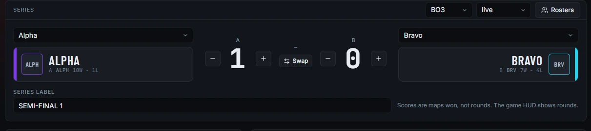
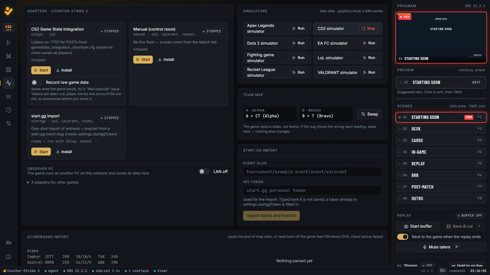
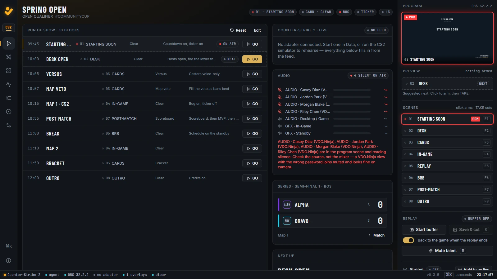
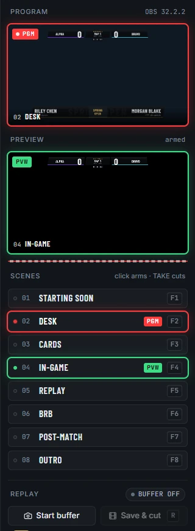
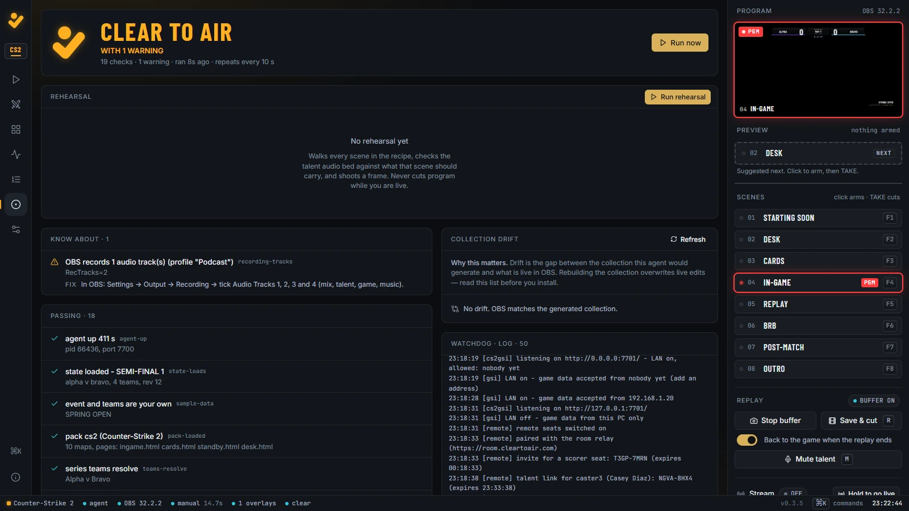

# Your first show in 30 minutes

Go from a fresh install to a show on air, using the demo teams and a simulator so you need no game running.

Before you start, finish [Getting started](getting-started.md): Clear to Air running, the OBS WebSocket server on, and OBS open.

## 0:00 Set the event (3 minutes)

1. Open the **Setup** tab.
2. Under **Event**, fill in **Name**, **Subtitle**, **Hashtag**, **Platform line** and **Prize**. A field saves when you leave it.
3. Under **Brand**, set **Primary**, **Secondary** and **Accent** colours, a **Logo URL** and a **Display font**. Your colours and font override the pack's.

Changing the event name clears the preflight fault "The sample event is still loaded".

To start from a clean desk instead, press and hold **Hold for new event**. It resets teams, series, rundown and prize, removes the sample talent, and keeps your own talent and settings. Every change is one **Ctrl Z** away.

## 0:03 Add the teams and the series (5 minutes)

1. Open the **Match** tab.
2. Under **Teams**, press **Team** to add one. Click a team to edit its **Name**, **Tag**, **Colour**, **Logo URL**, **Record** and **Note**. The short name the scorebug shows follows the name unless you type one.
3. Press **Rosters** in the **Series** panel to add players.
4. In **Series**, pick team A and team B from the two lists. Set the format (for example **BO3**) and the status (**upcoming**, **live** or **done**).
5. Give the series a **Series label**, such as `SEMI-FINAL 1`.

The series score is maps (or games) won, not rounds. Use the plus and minus buttons beside each team. **Swap** swaps team A and team B, scores included.

You can also fill teams from Liquipedia on the same tab, or import a whole bracket from start.gg. See [start.gg import](adapters.md#import-from-startgg).

## 0:08 Pick the game (2 minutes)

1. Open **Setup** and find **Title**.
2. Click the game's tile. A confirmation appears below the tiles.
3. Press and hold **Hold to switch**.

Switching resets the series maps, scores and format, the veto, draft, standings, set, match stats and pasted scoreboard. It keeps the event, brand, teams, talent, bracket, rundown and OBS settings. If OBS is connected, the live collection is repointed in place.

The panel below the tiles shows what the title gives you: its headline card, formats, map pool and which adapters it has.

## 0:10 Build the OBS collection (3 minutes)

If you have not installed it yet:

1. Close OBS.
2. Setup → **OBS collection** → **Hold to install**.
3. Open OBS and pick **ClearToAir** from the **Scene Collection** menu.

If it is already installed, check that the list under **In OBS** shows it as active. Press **Sync OBS to** your title if the collection was built for another one.

## 0:13 Connect the game feed (4 minutes)

Pick one of three sources on the **Data** tab.

**A simulator (fastest for this walkthrough).** Under **Simulators**, press **Run** next to your title. It feeds invented rounds, goals, kills or drafts through the same path as a real game. Every graphic shows a SIM marker. Press **Stop** before you go live: preflight warns while a simulator runs and faults if you are streaming or recording.

**A real game.** Find your game's adapter card, press **Install** to see or save its setup, then press **Start**. [Game data adapters](adapters.md) has the steps per game.

**A recorded match.** Play a recording into the running agent. See [Rehearse with recorded game data](replays.md#rehearse-with-recorded-game-data).

The **Live feed** panel shows the phase, round, clock, map, score and players as they arrive. If the scorebug shows the wrong team leading, press **Swap** in **Team map**.

## 0:17 Load the run of show (3 minutes)

1. Open the **Rundown** tab.
2. Press **Load default for** your title (for example **Load default for CS2**). The default is built from what the title supports, such as a standings block on Apex.
3. Edit each block: **Time**, **Title**, **Scene**, **Card** and **Notes**. Press **Block** to add one, and use the arrows to reorder.

Open the **Show** tab. **Run of show** lists the blocks, with the next one marked **next**. **GO** on a block cuts program straight to its scene, then sets its card and marks it done. If the cut fails, the card and rundown stay as they were. **GO next block** in **Next up** runs the next one.

## 0:20 Cut with ARM and TAKE (3 minutes)

A cut from the Air column is two steps: arm a scene into preview, then take it to air.

1. In the Air column on the right, click a scene under **Scenes**. It appears in **Preview**.
2. Click **TAKE**. It arms for 3 seconds and reads **ARMED · CLICK AGAIN TO TAKE**.
3. Click **TAKE** again within the 3 seconds. The scene goes to **Program**.

When nothing is armed, Preview suggests the next rundown block's scene. Clicking the suggestion only arms it.

The keyboard does the same while the control room window has focus:

| Key | Does |
|---|---|
| F1 to F8 | Arm scene 01 to 08 into preview |
| T | Arm TAKE; press again to take |
| Esc | Cancel a half-pressed TAKE, then clear the armed scene |
| 1 to 5 | Bug, ticker, corner tag, lower third, timeout |
| 0 | Clear the full-frame card |
| R | Save the replay and cut to 05 |
| M | Mute or unmute talent |
| Ctrl Z | Undo the last change |
| Alt + letter | Switch tab (hover a tab icon to see its letter) |

With Setup → OBS collection → **Fast cut: F1–F8 cut straight to air** switched on, F1 to F8 cut to program directly. It is off by default, and that is the recommended setting.

## 0:23 Try a replay (3 minutes)

1. Make sure OBS has its replay buffer enabled: in OBS, **Settings → Output → Replay Buffer**.
2. In the Air column under **Replay**, press **Start buffer**. The pill reads **buffer on**.
3. Press **Save & cut** (or R). OBS saves the clip and program cuts to **05 · REPLAY**.
4. When the clip ends, Clear to Air cuts back to the scene that was on before. The Air column shows "Back to 04 · IN-GAME in 6 s" with a **Hold** button.

Press **Hold** to stay on the replay this time. Switch off **Back to the game when the replay ends** to stop the cut back altogether. [Replays](replays.md) has the details.

## 0:26 Run Preflight and a rehearsal (3 minutes)

1. Open the **Preflight** tab and press **Run now**.
2. Fix every item under **Fix before air**. Each one names the tab and button to press.
3. Read the items under **Know about**.
4. Press **Run rehearsal**. It walks every scene, checks each scene's talent audio against what it should carry, and shoots a frame of each. While you are streaming or recording it only walks preview and never cuts program.
5. Stop the simulator on the Data tab, or start your real adapter.

## 0:29 Go live

1. In the Air column, find **Stream**.
2. Press and hold **Hold to go live** until it fills. OBS starts streaming and the pill reads **live**.
3. To record as well, press and hold **Hold to record**.

Ending works the same way: **Hold to end** and **Hold to stop**. The command palette (Ctrl K, or **⌘K** in the left rail) has the same actions, also behind a hold.

## Next

- [Connect a real game](adapters.md)
- [Bring in remote casters and crew](talent-links.md)
- [Troubleshooting](troubleshooting.md)
