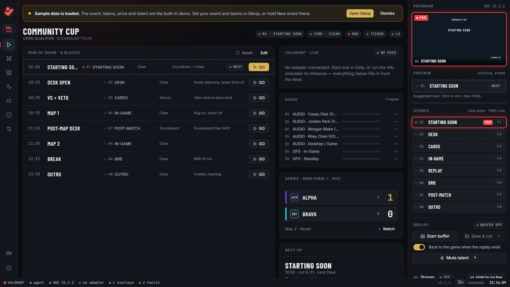
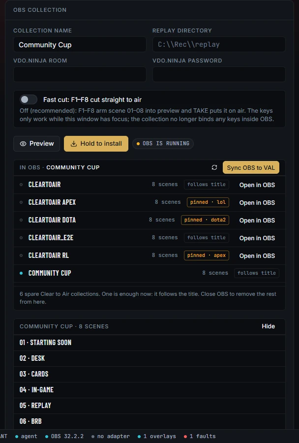
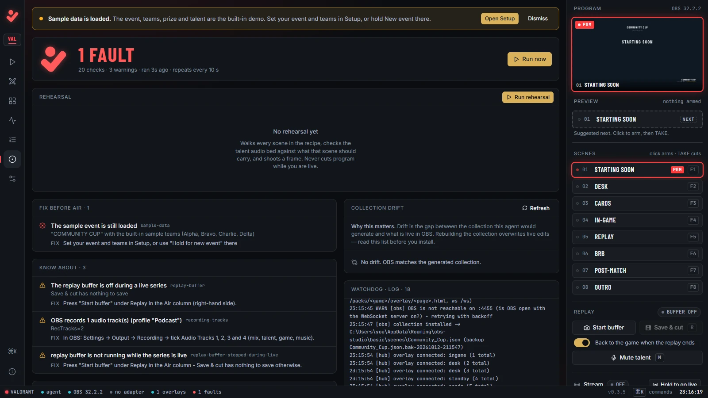

# Getting started

Install Clear to Air on the broadcast PC, connect it to OBS Studio, and build the OBS scene collection it drives.

## What you need

- A Windows 10 or 11 PC, 64-bit. This is the broadcast PC that runs OBS.
- OBS Studio with its WebSocket server. Clear to Air uses obs-websocket 5, on port 4455 by default. OBS 28 or later has it built in. Clear to Air is tested on OBS 32.2.2.
- At least 10 GB free on the recording drive for a show day. Preflight warns below 10 GB and faults below 2 GB.

## Install the Windows build

1. Open the [Releases page](https://github.com/downstagehq/cleartoair/releases) and download `ClearToAir-win64-<version>.zip`.
2. Unzip it somewhere you can write to, such as Documents. Do not use Program Files: updates and your saved show are written inside this folder.
3. Double-click **Clear to Air.exe**.

The folder carries its own Node runtime, so there is nothing else to install. Your saved show lives in `app\agent\data\` and survives updates. The log is `launcher.log`, next to the .exe.

## Find the tray lamp and the control room

When the agent answers, the launcher opens the control room in your browser at `http://127.0.0.1:7700/`. If the agent does not answer within 30 seconds, the tray says "The agent did not answer in 30 s. See launcher.log."

The tray icon is the lamp. Hover it to read the state, such as "CLEAR TO AIR", "preflight faults" or "agent not responding". Right-click it for **Open control room**, **Restart agent**, **Check for updates...**, **Open app folder**, **Open log** and **Quit**. If the agent stops, the launcher starts it again by itself.

The control room only listens on this PC. Nothing on the network can open it.



The demo event loads on first start: the COMMUNITY CUP on VALORANT, with the fictional teams Alpha, Bravo, Charlie and Delta. You can try everything with a simulator before you enter your own event.

## Switch on the OBS WebSocket server

1. Open OBS.
2. Go to **Tools → WebSocket Server Settings**.
3. Tick **Enable WebSocket server**.

Clear to Air reads the port and password from OBS's own settings and reconnects by itself. If it cannot read the password, enter it in Setup → Connections → **OBS WebSocket password**. The status bar shows **OBS** with its version once connected.

## Build the OBS scene collection

Clear to Air generates an OBS scene collection with eight scenes, **01 · STARTING SOON** to **08 · OUTRO**. It includes every overlay as a browser source, a game capture, the replay clip, desktop audio, and a camera and voice for each talent slot.

1. Close OBS. The install refuses to run while OBS is open, because OBS rewrites the collection file when it exits.
2. In the control room, open **Setup** and scroll to **OBS collection**.
3. Optional: press **Preview** to list the scenes it will build.
4. Press and hold **Hold to install** until it fills (under a second).
5. Read the message under the buttons. It says where the file went.
6. Open OBS and pick **ClearToAir** from the **Scene Collection** menu.

If a collection with that name already exists, the old file is kept beside it as a timestamped `.bak` copy.



One collection serves every title. When you switch title in Setup, the live collection is repointed in place. If OBS was closed at the time, press **Sync OBS to** your title (for example **Sync OBS to CS2**) once OBS is open.

## Read the lamp and Preflight

Preflight checks the setup every 10 seconds: OBS, the scenes, each scene's audio, the graphics, the game feed, the replay buffer, recording settings and disk space. Each check comes with a plain fix.

The lamp at the top of the left rail shows the result. Click it to open the **Preflight** tab.

| Lamp | Preflight says | Meaning |
|---|---|---|
| Green | **CLEAR TO AIR** | Every check passes. |
| Amber | **CLEAR TO AIR** with warnings | Nothing blocks air, but read the warnings. |
| Red | **N FAULTS** | Fix these before you go live. |
| Grey | **NOT CHECKED** | No result yet, or the control room has lost the agent. |

Press **Run now** to check again straight away.

On a fresh install the lamp is red on purpose: "The sample event is still loaded" stays a fault until you change the event name or the teams. [Your first show](first-show.md) covers that.



## Update Clear to Air

The launcher checks for an update when it starts, and from Tray → **Check for updates...**. When one exists, the status bar shows **update · v**_version_, and the launcher asks before installing.

It only installs an update whose manifest is signed with the project's release key, whose version is newer than yours, whose link is https, and whose zip matches the manifest's SHA-256 checksum. The launcher checks all of this itself, before extracting anything.

The agent restarts for a few seconds; OBS keeps running. Your show and cached team logos are kept. The graphics in OBS reload themselves once. The launcher itself is replaced the next time you start Clear to Air.

## Uninstall

Quit from the tray and delete the folder. Outside it, Clear to Air only writes the OBS collection you installed and, if you used **Install** on a CS2 or Dota 2 adapter, that game's `gamestate_integration_cleartoair.cfg`.

## Run from source

You need Node.js 22 or newer and Git.

```
git clone https://github.com/downstagehq/cleartoair.git
cd cleartoair
npm run setup
npm run build
npm start
```

Then open `http://127.0.0.1:7700/`. On Windows, `Clear to Air.cmd` does all of this; leave its window open while you are on air. The agent takes `--port <n>` and `--data-dir <dir>`. `CONTRIBUTING.md` has the developer setup and tests.

## Next

- [Your first show in 30 minutes](first-show.md)
- [Connect a game](adapters.md)
