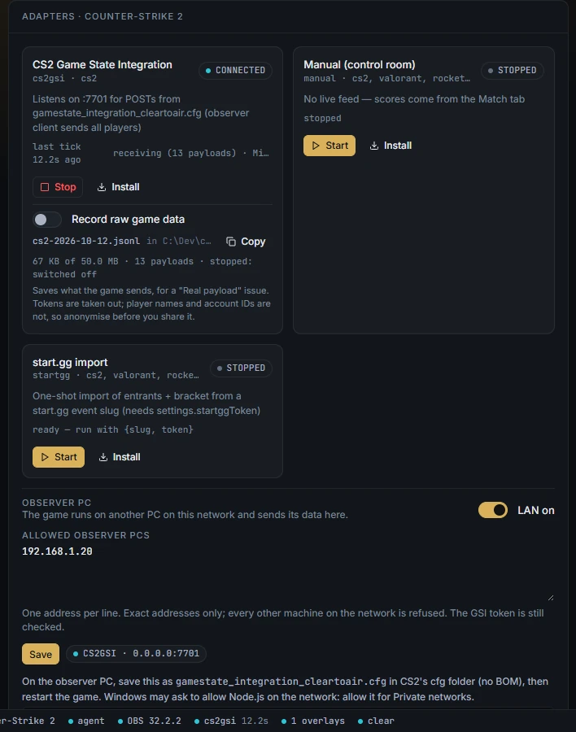
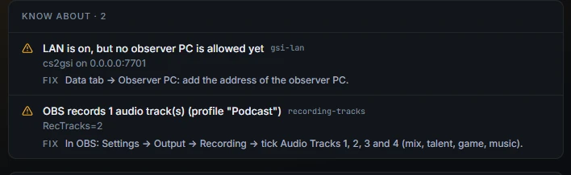

# Observer PC

Run CS2 or Dota 2 on a separate observer PC and send its game data to the broadcast PC over the venue network.

This was added in 0.3.3. It works for the two Game State Integration adapters only: CS2 and Dota 2. League of Legends, Rocket League and Apex still need the game on the broadcast PC.

**Status.** It has been tested over the broadcast PC's own network address. It has not yet been tested with a second PC on a real venue network.

## How it stays safe

LAN listening is off until you switch it on. While it is off, the game receivers only listen on the broadcast PC itself.

When you switch it on:

- The receivers accept game data from the addresses you list, one by one. There are no ranges, because a venue network is shared with players, and a range would let any machine on it put a score on air.
- Everyone else on the network is refused. Preflight names each refused address.
- The GSI token is still checked on every payload.
- The control room and the API stay on the broadcast PC only. Nothing else is opened to the network.
- You can list up to 16 observer PCs.

Only the broadcast PC itself can change this setting. A remote seat cannot.

## Connect an observer PC

You need the observer PC's IP address on the venue network, for example `192.168.1.20`.

1. On the broadcast PC, set the title to CS2 or Dota 2 (Setup → **Title**). The **Observer PC** panel only shows for these two.
2. Open the **Data** tab. Under the adapter cards, find **Observer PC**.
3. Switch it from **LAN off** to **LAN on**.
4. In **Allowed observer PCs**, type the observer PC's address. One address per line.
5. Press **Save**.
6. If the broadcast PC has more than one address (wired, Wi-Fi, a VPN), pick the one the observer PC can reach under "This PC on the observer's network".
7. Press **Copy** on the cfg shown below. It is the same cfg as on the broadcast PC, pointed at the broadcast PC's address and carrying the current token.
8. On the observer PC, save it as `gamestate_integration_cleartoair.cfg` in the game's cfg folder, without a UTF-8 BOM. For CS2 that is `...\Counter-Strike Global Offensive\game\csgo\cfg\`. For Dota 2 it is `...\dota 2 beta\game\dota\cfg\gamestate_integration\`, and the observer PC also needs the `-gamestateintegration` launch option.
9. Restart the game on the observer PC and spectate the match.
10. On the broadcast PC, make sure the adapter is started (Data tab → the adapter card → **Start**).

Windows may ask once whether Node.js may use the network. Allow it for **Private networks**.

## Check that it works

Below **Save**, a pill per running receiver shows where it listens:

- `cs2gsi · 0.0.0.0:7701` (or `dota2gsi · 0.0.0.0:7702`) means it accepts the listed addresses.
- An amber pill with `127.0.0.1` means the receiver has not rebound yet. Press **Save** again, or **Stop** and **Start** the adapter.

When data arrives, the adapter card turns **connected** and the **Live feed** panel fills in.

A **refused** pill lists any address that sent game data but is not on the list, with a count. If one of them is your observer PC, you typed the wrong address: add the one shown.

## Read the preflight checks

Preflight reports the observer setup in plain words:

| Check | Meaning | Fix |
|---|---|---|
| "Game data accepted from the LAN: ..." | Working as set. | None. |
| "LAN is on, but no observer PC is allowed yet" | The receivers listen, but nobody may send. | Add the observer PC's address. |
| "LAN is on but a receiver still listens on this PC only" | The receiver did not rebind. | Data tab → Observer PC → **Save**. |
| "Game data refused from N address(es) not on the list" | Someone sent game data and was turned away. | If it is your observer PC, add its address. If not, someone on this network is sending game data to the rig. |
| "A game receiver still listens on the LAN" | LAN was switched off but a receiver was not restarted. | Switch LAN off again, or **Stop** and **Start** the adapter. |

## Switch it off

Data tab → **Observer PC** → switch to **LAN off**. The receivers rebind to the broadcast PC only, and game data is accepted from this PC alone.

## Rules for the address list

- Exact IP addresses only. A range such as `192.168.1.0/24` is refused with "ranges are not accepted - list each observer PC".
- The broadcast PC itself is always allowed, so you do not list it.
- `0.0.0.0`, `::` and `255.255.255.255` are refused: none of them is a single machine.
- Edits to the list apply to the next payload. Switching LAN on or off restarts the receivers.

## Related

- [Connect CS2](adapters.md#connect-cs2) and [Connect Dota 2](adapters.md#connect-dota-2)
- [Troubleshooting: no game data from the observer PC](troubleshooting.md#no-game-data-from-the-observer-pc)
