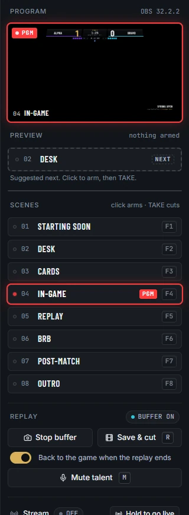
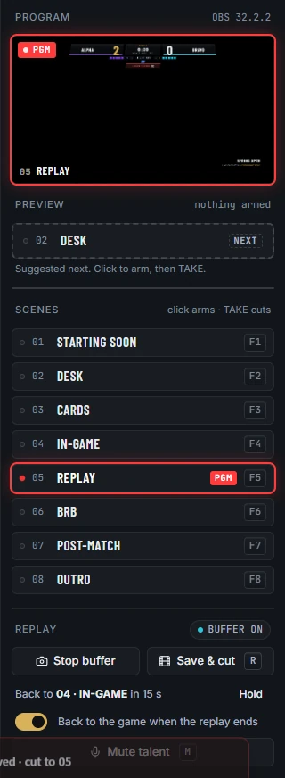
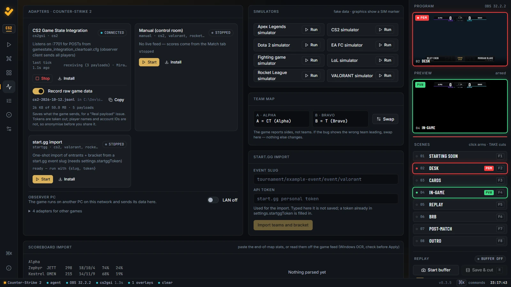

# Replays

Play back the last moments of the match from OBS's replay buffer, and rehearse a show on recorded game data.

## Turn on the replay buffer

OBS keeps the last stretch of program in memory and saves it as a clip on request. Clear to Air drives that buffer; OBS has to have it enabled first.

1. In OBS, open **Settings → Output → Replay Buffer** and enable it. Preflight warns "Replay buffer is off in OBS" until you do.
2. In the control room's Air column, under **Replay**, press **Start buffer**.
3. The pill beside **Replay** changes from **buffer off** to **buffer on**.

Press **Stop buffer** to stop it. While a series is set to **live** on the Match tab, preflight warns if the buffer is off, because Save & cut would have nothing to save.



## Save a replay and cut to it

Press **Save & cut** in the Air column, or press R.

1. OBS saves the buffer as a clip.
2. Clear to Air points the **REPLAY · Last Clip** source at the new file.
3. Program cuts straight to **05 · REPLAY**, and the clip plays from the start.

The command palette has the same action: **Save replay and cut to 05**.

**Save & cut** is greyed out until the buffer is on.

## Go back to the game after the replay

New in 0.3.4. When **05 · REPLAY** goes on program, Clear to Air remembers the scene that was on before. When the clip finishes, it cuts back to that scene using the scene's normal transition. If the scene before was not usable, it goes back to **04 · IN-GAME**.

It knows the clip has finished in two ways:

- OBS reports that the clip ended.
- As a backstop, Clear to Air reads the clip's length when the replay starts and cuts back 1.5 seconds after it should have ended, in case OBS never reports it.

This works however the replay got on air: **Save & cut**, the R key, or a cut to 05 by hand.

While it waits, the Air column shows where it will go and when, for example "Back to 04 · IN-GAME in 6 s".



### Stay on the replay

- **Hold** (beside the countdown) cancels the cut back for this replay only. Cut away yourself when you are done.
- If you cut to another scene before the clip ends, nothing happens: your cut wins.

### Switch the cut back off

Under **Replay** in the Air column, switch off **Back to the game when the replay ends**. It is on by default. The switch only shows on the broadcast PC, not on remote seats.

**Status:** tested in OBS 32.2.2, where Save & cut on a 7-second clip went back to 04 by itself 8.3 seconds later.

## Rehearse with recorded game data

A recording made with **Record raw game data** (see [Record raw game data](adapters.md#record-raw-game-data)) can be played back into Clear to Air with no game running. It arrives on the adapter's own port, at the recorded pace, so the graphics and OBS move as they did on the day.

| Recording from | Played back through |
|---|---|
| CS2 | the CS2 Game State Integration port, 7701 |
| Dota 2 | the Dota 2 Game State Integration port, 7702 |
| Rocket League | a stand-in Stats API on port 49123 |
| Apex Legends | the Apex LiveAPI port, 7777 |
| League of Legends | not supported live |

### In the Windows build

1. Set the title to the recording's game (Setup → **Title**).
2. Data tab → the game's adapter card → **Start**.
3. In File Explorer, drag the `.jsonl` file onto **Replay a recording.cmd** in the Clear to Air folder. Your recordings are in `app\agent\data\captures\`.
4. A window shows the progress. Press Ctrl+C there to stop.

For Rocket League, start the replay first and then press **Start** on the adapter: the adapter connects to the stand-in, as it would to the game.

### From source

```
npm run replay -- <file> --live
```

Options after `--live`:

- `--speed 4` plays four times faster.
- `--loop` starts again at the end.
- `--token <token>` sets the GSI token, if it does not match the one in the agent's saved show.

Without `--live`, it prints what the adapter made of the file instead: the phases, scores and events, the last frame, and anything that looks wrong, such as a player who changed team mid-map.

### Sample recordings

The repository holds synthetic recordings in `agent/src/adapters/fixtures/`, for CS2, Dota 2, League, Rocket League and Apex. They are built from each game's documented format, not captured from a game, and are not included in the Windows download. They are useful for trying the replay path; they do not prove an adapter matches the real game.



## Related

- [Troubleshooting: Save & cut does nothing](troubleshooting.md#save--cut-does-nothing)
- [Your first show](first-show.md)
