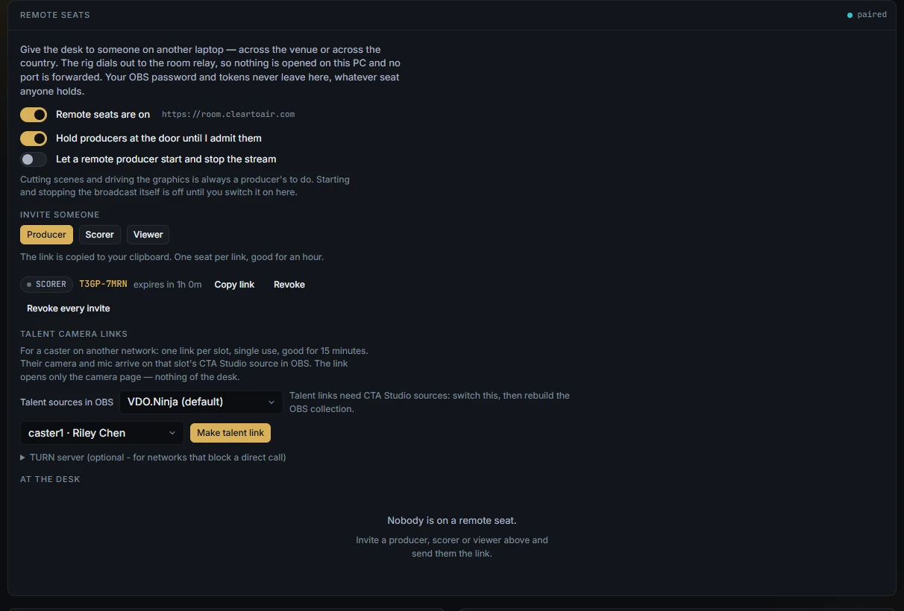
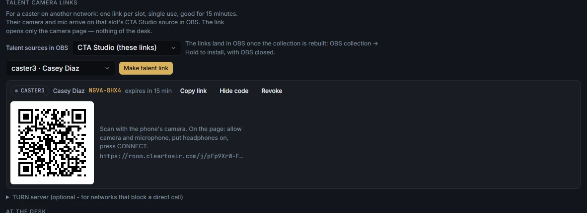
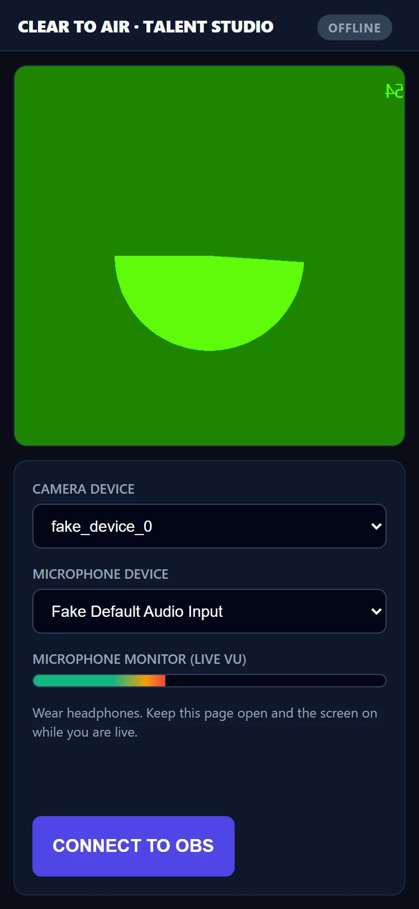

# Talent links and remote seats

Bring a caster's camera and mic in from another network, and let crew work the desk from another laptop.

Both go through a relay: a small Cloudflare Worker that the broadcast PC dials out to. Nothing on the broadcast PC is opened to the internet, and no port is forwarded. You can use the hosted relay at `https://room.cleartoair.com`, free while remote seats are in beta, or run your own (see `relay/README.md` in the repository). Neither is required: Clear to Air works fully without a relay.

## Choose how casters come in

There are two ways to get a remote caster into OBS.

| | VDO.Ninja (the default) | CTA Studio talent links (beta) |
|---|---|---|
| Set up in | Setup → **Talent** and Setup → **OBS collection** | Setup → **Remote seats** → **Talent camera links** |
| In OBS | A camera source and a separate voice source per talent slot, built into the collection | One browser source per slot carrying picture and voice together |
| Needs | A VDO.Ninja room | Remote seats switched on and paired with a relay |
| Status | The default | Beta |

For VDO.Ninja, add each person under Setup → **Talent** with a **Name**, **Role**, **Handle** and **Slot**. Each slot becomes a VDO.Ninja camera and a voice source in the generated collection. Set the **VDO.Ninja room** and **VDO.Ninja password** under **OBS collection**, then install the collection again (OBS closed, **Hold to install**).

The rest of this page covers talent links and remote seats.

## Connect to the relay

1. Open **Setup** and find **Remote seats**.
2. In **Room relay address**, paste `https://room.cleartoair.com` (or your own relay's address).
3. Press **Switch remote seats on**.
4. Wait for the lamp beside the panel title to read **paired**.

Later, the panel shows a switch instead of the address: **Remote seats are on** or **Remote seats are off**. Switching off drops every seat and the outbound connection.

## Make a talent link

**Status: beta.** Talent links were tested with two browsers on one PC, and over the internet through the hosted relay: the link opened over HTTPS, media flowed, and an agent restart, an OBS refresh and closing the seat all behaved. Phones and real-world networks (mobile carriers, strict NAT, venue Wi-Fi) are still untested. No TURN server was used in testing. There is no return feed to the caster yet.

1. Setup → **Remote seats** → **Talent camera links**.
2. Pick the slot. `caster1` to `caster4` are always listed; `caster5` to `caster8` appear when someone in Setup → **Talent** uses that slot number. Each slot is labelled with that talent's name.
3. Press **Make talent link**.

The link is copied to your clipboard, and its QR code appears on screen so the caster can scan it off the rig's monitor. **Show code** and **Hide code** toggle it.

Each link:

- opens the camera page for that one slot, and nothing of the desk;
- works once;
- expires after 15 minutes if unused.

**Revoke** kills an unused link. To end a link that is in use, press **Close seat** next to the caster under **At the desk**.

## Put the caster in OBS

The OBS collection builds VDO.Ninja sources for talent by default. Talent links need CTA Studio sources instead. Set this once per event (added in 0.3.5):

1. Setup → **Remote seats** → **Talent camera links** → **Talent sources in OBS**: pick **CTA Studio (these links)**.
2. Close OBS.
3. Setup → **OBS collection** → **Hold to install**.
4. Open OBS on the collection again.

Each talent slot now has one source, `TALENT · <name> (CTA Studio)`, that carries both picture and sound. **Mute talent** in the Air column mutes it.

This was tested with OBS 32.2.2 and room.cleartoair.com: a link opened in a phone-sized browser put its test camera on **02 · DESK**. A real phone on mobile data has not been tested yet.

Only one receiver can hold a slot. A browser tab that opens the same `view.html` takes the slot from OBS until OBS refreshes the source.
## What the caster does

Send the caster the one-page card [talent-quickstart.pdf](../talent-quickstart.pdf).

1. Open the link, or scan the QR code. Use Chrome or Safari.
2. Type a name under **Your name** and press **Take the seat**.
3. Allow the camera and the microphone. They should see themselves and the meter move.
4. Put on headphones, so the show does not hear itself back.
5. Press **CONNECT TO OBS** and wait for **CONNECTED · LIVE**. Leave the page open with the screen on.

| The page shows | Meaning |
|---|---|
| CONNECTED · LIVE | The desk has their picture and voice. |
| CONNECTING… | Just pressed. Give it a few seconds. |
| RECONNECTING… | It fixes itself; they are usually still on air. |
| OPENED ELSEWHERE | The link was opened on another device. |
| LINK CLOSED | The desk ended it. They need a new link. |
| OFFLINE | Not connected. Press **CONNECT TO OBS**. |

## How a talent link works

- The page comes from the relay over HTTPS, so the browser allows the camera.
- Only call setup goes through the relay. The picture and sound go directly between the caster and the broadcast PC.
- If the relay drops either end, or the agent restarts, the call carries on and the page reconnects to the same slot. If OBS refreshes its source, the call is set up again by itself.
- Everything the caster's page sends is rebuilt from known fields and rate-limited before it reaches OBS.

## Add a TURN server (optional)

Without TURN, a call between two strict networks can fail: some mobile carriers, or venue Wi-Fi that blocks UDP. The call then gives up after about 30 seconds.

1. Setup → **Remote seats** → **Talent camera links** → **TURN server (optional - for networks that block a direct call)**.
2. **TURN url(s)**: for example `turns:turn.example.com:443?transport=tcp, turn:turn.example.com:3478`.
3. Either **Shared secret (coturn use-auth-secret)** (preferred), or **Or: static username** and **Static credential**.

With a shared secret, the broadcast PC makes a short-lived login (12 hours) for each caster, and the secret never leaves the PC. Remote seats never see any of these fields.

## Invite a producer, scorer or viewer

A remote seat is the same control room, opened from the relay on another laptop.

| | Producer | Scorer | Viewer |
|---|---|---|---|
| Watch the desk, thumbnails and log | yes | yes | yes |
| Score, maps, veto, draft, standings, set, stats | yes | yes | no |
| Cards, bug, ticker, lower third | yes | no | no |
| Arm a scene, TAKE, replay, mute talent | yes | no | no |
| Start or stop the stream or recording | only if you allow it | no | no |

1. Setup → **Remote seats** → **Invite someone** → **Producer**, **Scorer** or **Viewer**. The link is copied. One seat per link, good for an hour.
2. Send the link. The guest types a name and presses **Take the seat**.
3. Producers wait at the door while **Hold producers at the door until I admit them** is on (the default). The status bar shows **N at the door**. Press **Admit** or **Turn away** under **At the desk**.
4. **Close seat** removes one guest. Press and hold **Clear every seat** to remove them all.

**Let a remote producer start and stop the stream** is off by default.

A guest's status bar reads **remote · producer** (or scorer, viewer). Your OBS password and tokens never leave the broadcast PC, whatever seat anyone holds. OBS collections, simulators, adapter installs, the updater and the seat list are never reachable from a seat.

`docs/REMOTE.md` ([REMOTE.md](../REMOTE.md)) has the full security model and how it was tested.
