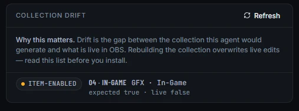
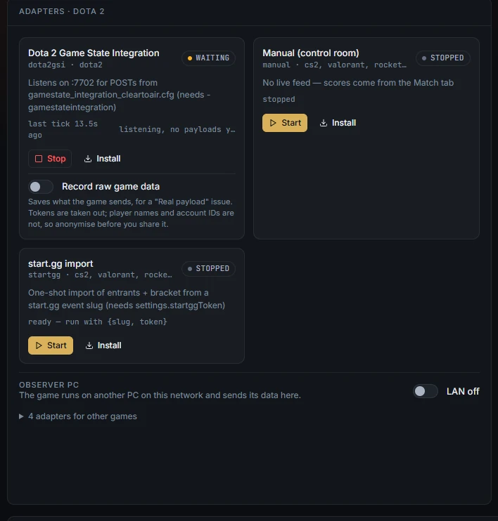

# Troubleshooting

Find the symptom, read the likely cause, and apply the fix.

Start with the **Preflight** tab. It runs every 10 seconds, and every fault and warning names the tab and button that fixes it. The checks are listed at the end of this page.

## Where the log is

- **Windows build:** `launcher.log`, next to `Clear to Air.exe`. Tray → **Open log** opens it in Notepad. It holds the launcher's lines and the agent's output, in this PC's local time. It rolls over at about 2 MB to `launcher.log.old`.
- **From source:** the agent writes to the console window it runs in.
- **In the control room:** Preflight → **Watchdog · log** shows recent lines.

Before you attach a log or saved show to an issue, remove passwords, tokens and invite links.

## The control room does not open

**The tray says "The agent did not answer in 30 s. See launcher.log."**
Cause: the agent could not start. The commonest reason is that port 7700 is taken, usually by another copy of Clear to Air. The log then reads "port 7700 is already in use - is another agent running?".
Fix: quit the other copy (another tray lamp, or a `Clear to Air.cmd` window), then Tray → **Restart agent**. From source, you can also start the agent with `--port <n>`.

**"runtime\node.exe is missing next to Clear to Air.exe."**
Cause: the zip was not fully extracted.
Fix: extract the whole zip again, to a folder you can write to.

**The browser shows "Control room not built yet".**
Cause: running from source without a build.
Fix: run `npm run build`, then reload.

## OBS shows as offline

**Preflight: "OBS is not connected".** The status bar reads **OBS offline**.
Cause: OBS is closed, or its WebSocket server is off.
Fix: open OBS, then **Tools → WebSocket Server Settings → Enable WebSocket server**. Clear to Air reconnects by itself. If Clear to Air cannot read the WebSocket password from OBS's settings, enter it in Setup → Connections → **OBS WebSocket password**.

## Installing the collection fails

**"OBS is running - close it first, OBS rewrites the collection file on exit".**
Fix: close OBS completely, then press **Hold to install** again.

**Preflight: "N/8 show scenes found in OBS".**
Cause: OBS has another collection open, or scenes were renamed.
Fix: in OBS, pick **ClearToAir** from the **Scene Collection** menu. If it is missing, close OBS and install it from Setup → **OBS collection**.

## The graphics are blank, old or from the wrong game

**Preflight: "N graphics page(s) not running in OBS".**
Fix: press Ctrl K and choose **Refresh graphics browser sources**. If it stays red, the collection is missing that page: close OBS and install the collection again.

**Preflight: "OBS shows graphics from http://127.0.0.1:NNNN, not this Clear to Air".**
Cause: the collection was built by an agent on another port.
Fix: Setup → **OBS collection** → **Sync OBS to** your title. It repoints the graphics without closing OBS.

**Preflight: "Graphics are hidden behind the game capture in ...".**
Fix: press **Sync OBS to** your title. It moves the game capture under the graphics.

**The overlays show the wrong game.**
Cause: the collection was installed before the title switch, while OBS was closed, or it is an old per-game collection.
Fix: press **Sync OBS to** your title. In the **In OBS** list, a collection marked **pinned** belongs to one game; sync it or install the current one.

**A SIM marker is on the graphics.**
Cause: a simulator is running. Preflight warns, and faults while you stream or record.
Fix: Data tab → **Simulators** → **Stop**.

## The OBS collection has drifted

Preflight → **Collection drift** lists every difference between the collection Clear to Air would build and what is live in OBS: missing scenes or items, extra items, hidden items, audio routing and changed browser-source addresses.

Drift is not always a problem. A source you added on purpose shows as an extra item. Read the list before you reinstall: **installing again overwrites your edits in OBS**. The old file is kept as a `.bak` copy.

## No game data

**The adapter card says waiting.**
Read the detail line on the card:

| Detail | Cause | Fix |
|---|---|---|
| "listening, no payloads yet" (CS2, Dota 2) | The game is not sending. | Check the cfg is installed, restart the game, and spectate. Dota 2 also needs `-gamestateintegration`. |
| "... rejected: bad token" | The cfg's token does not match Setup → Connections → **GSI token**. | Press **Install** again and restart the game. |
| "stale — last payload N s ago" | The game stopped sending. | Check the game or spectator client is still in the match. |
| "no game client on :2999" (League) | No League game is running on this PC. | Spectate the match on the broadcast PC. |
| "searching for Stats API :49123 / SOS :49122" (Rocket League) | The Stats API is off or on another port. | Set `PacketSendRate=30` and `Port=49123` in the ini, then restart Rocket League. |
| "listening on :7777, game not connected" (Apex) | The game was launched without the LiveAPI options, or before the adapter. | Check the launch options, start the adapter, then launch Apex. |

**Preflight: "No game data: the ... adapter is not running".**
Fix: Data tab → that adapter → **Start**. Scoring by hand on purpose? Start **Manual (control room)** instead, and the warning clears.

**Preflight: "... running but no game data for N s".**
Fix: open the game or spectator client and check its setup (Data tab → the adapter card → **Install**). Or press **Stop** on the adapter so scores follow the Match tab.

**CS2 shows only one player.**
Cause: the client is playing, not spectating. A playing client only sends its own player.
Fix: spectate through the Watch tab, GOTV or a demo.

**The scorebug shows the wrong team leading.**
Cause: the game reports sides, not teams.
Fix: Data tab → **Team map** → **Swap**.

## An adapter will not start

**A message such as "CS2 Game State Integration: start failed", naming EADDRINUSE.**
Cause: another program already listens on the adapter's port: 7701 for CS2, 7702 for Dota 2, 7777 for Apex. It may be a second Clear to Air, or another game-data tool.
Fix: close the other program, then press **Start** again.

Rocket League and League work the other way round: the game opens the port (49123 and 2999) and Clear to Air connects to it. A clash there shows as no data, not as a failed start.

**Install says it could not find the game.**
Cause: the game is not in a Steam library Clear to Air can see, or Steam is not installed in the usual way.
Fix: press **I'll save it myself**, copy the file, and save it into the folder the steps name, without a UTF-8 BOM.

**Install says "Windows refused to write ...".**
Fix: save the file by hand as above, or check the game folder is not read-only.

## No game data from the observer PC

- **The refused pill or preflight lists the observer's address.** It is not on the list. Add exactly that address in Data tab → **Observer PC** and press **Save**.
- **Nothing is refused, and nothing arrives.** The data is not reaching the broadcast PC. Check Windows allowed Node.js on Private networks when it asked, that both PCs are on the same network, and that the cfg on the observer PC points at the broadcast PC's address (the one picked under "This PC on the observer's network").
- **"rejected: bad token".** The observer's cfg is from before a token change. Copy it again from the Observer PC panel.

See [Observer PC](observer-pc.md).

## Save & cut does nothing

**"replay buffer is not running - start it first".**
Fix: Air column → **Replay** → **Start buffer**. If that fails, enable the buffer in OBS: **Settings → Output → Replay Buffer**.

**"replay saved but OBS did not report a file path".**
Cause: OBS did not finish writing the clip within about 5 seconds.
Fix: check OBS's recording path exists and has space (Settings → Output → Recording).

**The replay plays but does not cut back.**
Cause: **Back to the game when the replay ends** is off, someone pressed **Hold**, or there is no **04 · IN-GAME** scene to go back to.
Fix: switch it on under **Replay** in the Air column.

## Talent is silent or missing

**"No talent audio in OBS"** on the mute button.
Cause: OBS has no source named `AUDIO · <name> (VDO.Ninja)` or `TALENT · <name> (CTA Studio)`.
Fix: install the collection from Setup, or name a hand-made talent source that way.

**Watchdog: "N camera(s) on air with a silent audio twin".**
Cause: a VDO.Ninja voice source did not reconnect. Clear to Air reloads it once by itself.
Fix: if it stays silent, ask the person to leave and rejoin with the same invite link.

**Preflight: "Two talent share a camera slot".**
Fix: Setup → **Talent**: give everyone their own slot number.

## Preflight checks

| Check | Level | Fix |
|---|---|---|
| The sample event is still loaded | Fault | Set your event and teams in Setup, or hold **Hold for new event**. |
| Your saved show could not be read | Fault | Check the event, teams, scores and rundown before air. It was restored from a backup or the defaults. |
| The game "..." is not installed | Fault | Setup → **Title**: pick an installed game. |
| The series is missing a team | Fault | Match tab → **Series**: pick both teams. |
| Veto steps belong to a team that is not playing | Fault | Match tab → **Veto**: remove those steps and enter them again. |
| A rehearsal source is visible on air | Fault | In OBS, hide or delete every source named "TEST ONLY" in the program scene. |
| Audio bed problems | Fault | Make desktop audio visible in every show scene; only casters in 03, 04 and 05; nobody in 06 · BRB. Or install the collection again. |
| FAKE game data is on the graphics while you are streaming | Fault | Data tab → **Simulators** → **Stop**, now. |
| The recording drive is almost full (under 2 GB) | Fault | Free space, or pick another recording path in OBS. |
| The recording drive is low (under 10 GB) | Warning | Free at least 10 GB. |
| OBS records fewer than 4 audio tracks | Warning | OBS → Settings → Output → Output Mode: **Advanced**, then tick Audio Tracks 1 to 4. |
| Replay buffer is off in OBS | Warning | OBS → Settings → Output → Replay Buffer. |
| The replay buffer is off during a live series | Warning | Air column → **Start buffer**. |

## Report a bug

Open an issue at [github.com/downstagehq/cleartoair/issues](https://github.com/downstagehq/cleartoair/issues). Include the version from the status bar, the steps, and the relevant part of `launcher.log`, with passwords, tokens and invite links removed.
